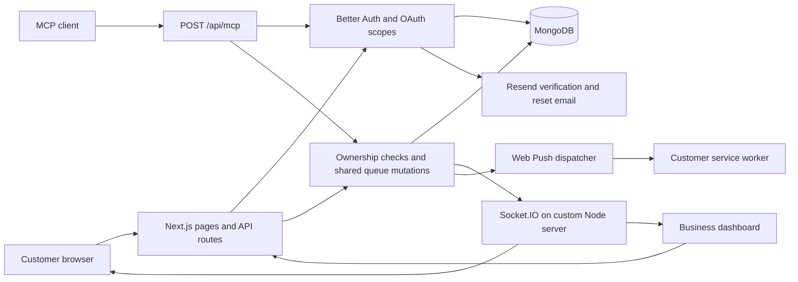

# QZEN

Digital queue management for businesses and their customers. Operators manage queues from a dashboard; customers join through a shareable link or QR code and follow their ticket without standing in a physical line.

[Demo](https://qzen.onrender.com/) · [Source](https://github.com/Aswnxyz/qzen)

**Status:** actively developed portfolio application. The demo landing page responded on 18 October 2026; this is not verification of every authenticated workflow or a production-readiness claim. The Render instance may take time to start.

## Implemented workflows

- Business profiles and owner-scoped queue management.
- Shareable customer routes at `/join/[businessSlug]/[queueSlug]`, QR codes and numbered tickets.
- Daily queue sessions based on the business timezone, with active, paused and closed states.
- Call-next, complete and skip operations; queue updates delivered through Socket.IO.
- Dashboard summaries, queue history and analytics.
- Optional browser push notifications for called tickets, approaching turns and queue state changes.
- Email/password authentication with email OTP verification, password reset and Google sign-in configuration.
- Authenticated MCP tools for queue operations, business settings and analytics.

These features are represented in source; service credentials and a running database are required to exercise them.

## Stack and architecture

Next.js 16 App Router, React 19, TypeScript, Tailwind CSS, MongoDB/Mongoose, Better Auth, Socket.IO, Web Push, Resend, Zod, Recharts and the MCP server SDK. Exact versions and commands are in [package.json](package.json).



The custom [server.ts](server.ts) serves Next.js and Socket.IO in one Node process. HTTP management routes and MCP tools reuse the mutation layer in `src/lib/queueMutations.ts`, so their ownership checks and state transitions have a common implementation. Mongoose handles application models; Better Auth uses its MongoDB adapter and the `qzen` database. Use a MongoDB URI whose database is also `qzen` to keep these aligned.

### Authentication and authorization

Better Auth manages sessions and sign-in. Email/password accounts require verification; the email OTP configuration uses six digits, a ten-minute expiry and three attempts. Password reset revokes existing sessions. Resend's sender is currently the development sender configured in `src/lib/auth.ts`; email delivery outside a permitted test setup requires an appropriate verified sender.

`src/lib/authorization.ts` resolves a queue through its business owner. Management endpoints and MCP tools use owner-scoped access; customer queue joining is intentionally public. This is not a blanket claim that every endpoint has completed a security audit.

### Real-time updates and notifications

Browsers join `queue:<queueId>` rooms and receive `queueUpdated` events. A mutation persists its changes before notifying clients. Push subscriptions are stored separately; the dispatcher targets the current session's waiting entries and uses a marker to avoid repeating the approaching-turn alert. Stale push endpoints are removed on 404/410 responses. Push errors are caught so they do not fail queue operations.

Web Push requires browser permission, a service worker and HTTPS outside localhost. If any VAPID setting is missing, push is disabled and the subscription configuration endpoint returns 503. Socket.IO updates still have their own server requirement.

### MCP integration

The application endpoint is `POST /api/mcp`. Better Auth provides OAuth discovery, login/consent, dynamic client registration and CIMD support. The handler requires `mcp:read`; mutation tools additionally require `mcp:write` and an owned business/queue.

Tools include `ping_qzen`, `list_queues`, `get_queue_status`, `get_waiting_customers`, `get_queue_session`, queue creation/update/deletion, call/complete/skip operations, `update_business_settings`, `get_today_summary`, `get_queue_statistics` and `get_queue_history`.

The separate `mcp/` package is a **stdio ping prototype**, not the full authenticated queue API. Use the application endpoint for queue operations.

## Local setup

Use Node.js 24 LTS (the scripts execute `server.ts` directly), npm, a dedicated MongoDB database and development credentials for the integrations you exercise.

```bash
git clone https://github.com/Aswnxyz/qzen.git
cd qzen
npm ci
```

Copy `.env.example` to `.env.local`, then fill in local values. The example below contains placeholders only:

```dotenv
MONGODB_URI=mongodb://127.0.0.1:27017/qzen
BETTER_AUTH_SECRET=replace-with-a-generated-local-secret
BETTER_AUTH_URL=http://localhost:3000
GOOGLE_CLIENT_ID=replace-with-development-client-id
GOOGLE_CLIENT_SECRET=replace-with-development-client-secret
RESEND_API_KEY=replace-with-development-api-key
MCP_RESOURCE_URL=http://localhost:3000/api/mcp
VAPID_PUBLIC_KEY=
VAPID_PRIVATE_KEY=
VAPID_SUBJECT=
```

Register the Google callback for your development origin in the provider configuration. Generate a fresh push key pair with `npx web-push generate-vapid-keys` when testing push; use a valid `mailto:` or HTTPS contact URI for `VAPID_SUBJECT`. Keep the private key server-side. Never commit populated environment files.

```bash
npm run dev
```

Open `http://localhost:3000`. Create and verify a test operator, create a business and queue, then activate the day's session before joining as a customer.

| Command | Purpose |
| --- | --- |
| `npm run dev` | Custom Node/Next.js development server with Socket.IO |
| `npm run build` | Next.js production build |
| `npm start` | Custom server with `NODE_ENV=production` |
| `npm run lint` | ESLint |
| `npx tsc --noEmit` | Type checking |
| `npm run test:oauth` | OAuth integration harness |
| `npm run test:mcp` | MCP tool integration harness |
| `npm run test:analytics` | Analytics integration harness |

## Verification

Run lint, type checking and build after installing dependencies. Integration scripts load `.env.local`, default to `http://localhost:3000`, create test records and directly update the test user's verification state in MongoDB. Run them only against a disposable local database and a separately running development server. Review `e2e-mcp-lib.mjs` and the selected harness first; `BASE_URL`, `TEST_EMAIL` and `TEST_PASSWORD` can override test defaults. Do not point them at a shared or live database.

Manual checks: use separate operator/customer browser contexts; verify joining, pause/resume, call-next, completion, skipping, reload persistence, denied cross-business access and notification permission denial. Test push on a supported browser with your own subscription. No integration test pass is implied by the presence of these scripts, and no automated CI workflow is committed.

## Project map

```text
server.ts                 Next.js + Socket.IO HTTP server
src/app/                  Public pages, dashboard, auth, API and discovery routes
src/components/           Customer, dashboard and landing interfaces
src/lib/                  Auth, ownership, mutations, analytics, history and MCP tools
src/lib/notifications/    Push subscription and dispatch logic
src/models/               Business, Queue, QueueSession, QueueEntry and related models
public/sw.js              Push service worker
e2e-mcp-*.mjs             Local integration harnesses
mcp/                      Separate stdio ping prototype
```

## Limits and next engineering work

- Socket.IO lives in process memory. A multi-instance deployment needs a shared adapter and routing strategy; a static or ordinary serverless Next.js deployment alone does not run `server.ts`.
- The Vercel landing page can respond without demonstrating the custom real-time server. Use the Render demo above; validate full workflows separately.
- Public join currently derives the next token by reading the latest entry before creating a new one. Concurrent joins need an atomic allocation strategy and regression coverage.
- Socket room joins accept a queue identifier without an authentication gate. Review what each room broadcasts before using sensitive customer data.
- Push delivery is best effort; retries, observability, rate limits and broader concurrency tests remain useful follow-up work.
- No performance, uptime or usage claims are made here. Screenshots and a recorded end-to-end walkthrough are still useful additions.
